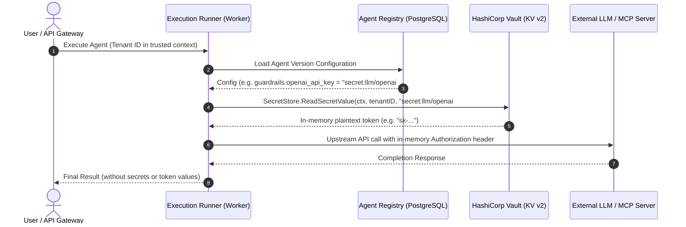

# ARDA — HashiCorp Vault Integration v1 Documentation

This document describes the design, configuration, security model, and usage of the HashiCorp Vault integration package (`pkg/vault`) for ARDA.

---

## 1. Architecture & Design Principles

ARDA uses **HashiCorp Vault KV v2** as its foundational secrets management engine. The integration is implemented as a lightweight, reusable Go package (`github.com/aswinsreeraj/arda/pkg/vault`), avoiding heavy dependency graphs while strictly enforcing tenant isolation and defense-in-depth security.

### Core Principles

1. **Strict Tenant Namespace Isolation**:
   - Vault paths are permanently rooted at `tenants/<tenant_id>/<validated_key>`.
   - Tenant identity is derived exclusively from trusted application contexts (`uuid.UUID`), never from untrusted client headers, request bodies, or user-controlled paths.
2. **Deterministic Path Sanitization**:
   - Keys are validated to prevent directory traversal (`..`), absolute paths, null bytes, backslashes, and namespace substitution.
3. **Redaction & Leak Prevention**:
   - Secret payloads, API keys, and Vault tokens are **never** included in logs, error objects, or string formatters.
   - Errors are wrapped in `SanitizedError` and mapped to domain sentinels (`ErrSecretNotFound`, `ErrVaultAuthentication`, `ErrVaultUnavailable`, `ErrInvalidReference`).
4. **Clean Dependency Injection**:
   - Exposes the minimal `SecretStore` interface.
   - Includes `MemoryStore` for unit testing calling services without network dependencies.
5. **Fail-Closed Configuration**:
   - The client fails closed immediately during initialization if the Vault address or authentication credentials are missing or empty.

---

## 2. Configuration Variables

| Variable | Default (Local) | Description |
|---|---|---|
| `VAULT_ADDR` | `http://127.0.0.1:8200` | HTTP/HTTPS address of the Vault server. |
| `VAULT_TOKEN` | `root` | Authentication token (local dev root token or service token). |
| `VAULT_MOUNT` | `secret` | KV v2 mount path. Standard dev Vault mounts at `secret/`. |
| `VAULT_TIMEOUT` | `5s` | Bounded request timeout (e.g. `2s`, `5s`, `10s`). |

---

## 3. Secret Reference Format

The Agent Registry v1 stores agent configurations in PostgreSQL with secret references instead of raw credentials. `pkg/vault` implements full compatibility with this convention:

### Supported Formats

- **`secret:<key>`** (Canonical reference):
  Example: `secret:llm/openai` or `secret:vault-openai-key`
- **`secret:<key>#<field>`** (Field selector):
  Example: `secret:llm/openai#api_key` or `secret:mcp/slack#bot_token`
- **`ref:<key>`** or **`ref:<key>#<field>`**:
  Alternate reference prefix recognized by Agent Registry validation.
- **`<key>`**:
  Direct relative key within the tenant namespace.

### Key Validation Rules

- Must be between 1 and 255 characters.
- Must not contain `..` or `.` path traversal segments.
- Must not start with `/` or end with `/`.
- Must not contain consecutive slashes (`//`) or backslashes (`\`).
- Path segments separated by `/` must each start with an alphanumeric character `[a-zA-Z0-9]` and contain only `[a-zA-Z0-9_.-]`.
- Reserved root segments (`tenants`, `sys`, `auth`, `v1`, `v2`, `secret`, `admin`) are strictly forbidden.

---

## 4. Tenant Isolation & Storage Hierarchy

Vault KV v2 endpoints follow the convention:

```
GET/POST/DELETE /v1/{VAULT_MOUNT}/data/tenants/{tenant_id}/{key}
```

### Isolation Example

For Tenant `a0000000-0000-0000-0000-000000000001` and secret reference `secret:llm/openai`:
- Resolved Vault Path: `/v1/secret/data/tenants/a0000000-0000-0000-0000-000000000001/llm/openai`

If Tenant `b0000000-0000-0000-0000-000000000002` queries the identical reference `secret:llm/openai`:
- Resolved Vault Path: `/v1/secret/data/tenants/b0000000-0000-0000-0000-000000000002/llm/openai`
- Returns `ErrSecretNotFound` (HTTP 404) if Tenant B has not written its own secret.

Even if an attacker passes:
- `secret:../a0000000-0000-0000-0000-000000000001/llm/openai`
- `secret:tenants/a0000000-0000-0000-0000-000000000001/llm/openai`

The validator rejects the reference with `ErrInvalidReference` before any HTTP request is dispatched.

---

## 5. Runtime Secret Resolution (Future Agent & MCP Execution)

In future development milestones (Agent Execution Engine & MCP Tool Connector):



1. **No Client Exposure**: Plaintext secret values are **never** returned to API Gateway clients or end users.
2. **No PostgreSQL Storage**: PostgreSQL only stores the string pointer `secret:llm/openai#api_key`.
3. **Execution Context Injection**: The worker resolves the secret in-memory immediately prior to upstream tool or LLM invocation.

---

## 6. Minimal Internal Interface (`SecretStore`)

```go
package vault

import (
    "context"
    "github.com/google/uuid"
)

type SecretStore interface {
    WriteSecret(ctx context.Context, tenantID uuid.UUID, key string, data map[string]string) error
    ReadSecret(ctx context.Context, tenantID uuid.UUID, ref string) (map[string]string, error)
    ReadSecretValue(ctx context.Context, tenantID uuid.UUID, ref string) (string, error)
    DeleteSecret(ctx context.Context, tenantID uuid.UUID, key string) error
}
```

---

## 7. Local Development & Testing Instructions

### Starting Vault with Docker Compose

Start PostgreSQL and Vault locally:

```bash
docker compose -f deployments/local/docker-compose.yml up -d
```

Verify service status:

```bash
docker compose -f deployments/local/docker-compose.yml ps
```

### Running Automated Tests

Run the full repository test suite and vet checks:

```bash
go test -count=1 ./...
go vet ./...
```

The `pkg/vault` test suite tests:
- Valid multi-field write and retrieval.
- Missing secret 404 handling.
- Tenant isolation across multiple tenants.
- Path traversal and forbidden namespace rejection.
- Vault authentication failure and service unavailability.
- Bounded request timeouts.
- Error redaction asserting secret payloads and tokens are never leaked.
- `MemoryStore` interface contract verification.
- Reference parsing and formatting compatibility with Agent Registry.

---

## 8. Limitations & Future Platform Milestones

- **Development Mode Vault**: Local development uses Vault in `-dev` mode (`root` token). Production deployments must use Vault HA with KMS auto-unseal, TLS 1.3, and AppRole or Kubernetes dynamic token renewal.
- **Dynamic Secrets / Leases**: This milestone implements static KV v2 secret storage and resolution. Dynamic credential generation (e.g. Vault database secrets engine with TTLs) will be added in a future milestone.
- **Secrets Management UI**: Public secret CRUD endpoints are intentionally not exposed at the API Gateway per security architecture; secrets are provisioned via administrative channels or future internal management flows.
